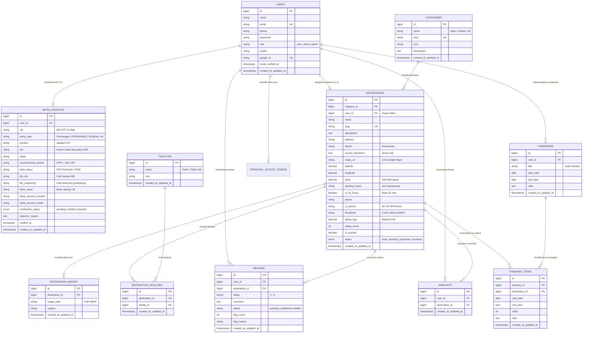

# SKEMA DATABASE LENGKAP — DOKEMAS BANYUMAS
## Database Engine: MySQL / TiDB Cloud Serverless (AWS Singapore)
Dokumen ini mendefinisikan seluruh arsitektur tabel, tipe data, relasi, dan kamus data (*Data Dictionary*) resmi dari sistem backend **DOKEMAS Banyumas** yang saat ini aktif digunakan oleh aplikasi Mobile (Flutter) dan API Service.

---

## 1. Entity-Relationship Diagram (ERD)

---

## 2. Kamus Data Rinci (*Data Dictionary*)

### 2.1. Domain Pengguna & Kemitraan

#### Tabel: `users`
Menyimpan seluruh data akun pengguna (wisatawan, pengelola mitra, dan admin dinas).
| Kolom | Tipe Data | Nullable | Default | Keterangan / Constraint |
| :--- | :--- | :--- | :--- | :--- |
| `id` | `BIGINT UNSIGNED` | NOT NULL | AUTO_INCREMENT | **Primary Key** |
| `name` | `VARCHAR(255)` | NOT NULL | - | Nama lengkap pengguna / PIC |
| `email` | `VARCHAR(255)` | NOT NULL | - | **Unique**, email akun login |
| `phone` | `VARCHAR(255)` | NULL | NULL | Nomor telepon / WhatsApp pengelola |
| `email_verified_at` | `TIMESTAMP` | NULL | NULL | Tanggal verifikasi email |
| `password` | `VARCHAR(255)` | NULL | NULL | Hash password (Bcrypt) |
| `role` | `VARCHAR(255)` | NOT NULL | `'user'` | Role akun: `'user'`, `'mitra'`, `'admin'` |
| `avatar` | `VARCHAR(255)` | NULL | NULL | Path foto profil avatar |
| `google_id` | `VARCHAR(255)` | NULL | NULL | **Unique**, ID OAuth Google |
| `remember_token` | `VARCHAR(100)` | NULL | NULL | Token sesi "Remember Me" |
| `created_at` | `TIMESTAMP` | NULL | NULL | Waktu akun dibuat |
| `updated_at` | `TIMESTAMP` | NULL | NULL | Waktu akun diperbarui |

#### Tabel: `mitra_profiles`
Menyimpan data legalitas usaha, izin operasional, rekening bank, dan status kurasi penanggung jawab mitra.
| Kolom | Tipe Data | Nullable | Default | Keterangan / Constraint |
| :--- | :--- | :--- | :--- | :--- |
| `id` | `BIGINT UNSIGNED` | NOT NULL | AUTO_INCREMENT | **Primary Key** |
| `user_id` | `BIGINT UNSIGNED` | NOT NULL | - | **Foreign Key** ke `users.id` (Relasi 1:1) |
| `nik` | `VARCHAR(20)` | NULL | NULL | Nomor Induk Kependudukan (16 digit) |
| `entity_type` | `VARCHAR(255)` | NOT NULL | `'Perorangan'` | Bentuk usaha (Perorangan, POKDARWIS, BUMDes, dll) |
| `position` | `VARCHAR(255)` | NOT NULL | `'Pengelola'` | Jabatan PIC dalam pengelolaan |
| `nib` | `VARCHAR(50)` | NULL | NULL | Nomor Induk Berusaha (OSS-RBA) |
| `npwp` | `VARCHAR(50)` | NULL | NULL | Nomor Pokok Wajib Pajak usaha/pribadi |
| `environmental_permit` | `VARCHAR(255)` | NULL | NULL | Izin lingkungan (SPPL, UKL-UPL, AMDAL) |
| `land_status` | `VARCHAR(255)` | NULL | NULL | Status kepemilikan lahan (PKS Perhutani, SHM, dll) |
| `file_nib` | `VARCHAR(255)` | NULL | NULL | Path file dokumen scan NIB (PDF/Gambar) |
| `file_supporting` | `VARCHAR(255)` | NULL | NULL | Path berkas pendukung / izin kerjasama |
| `bank_name` | `VARCHAR(100)` | NULL | NULL | Bank penampung (misal: Bank Jateng, BCA, BRI) |
| `bank_account_number` | `VARCHAR(50)` | NULL | NULL | Nomor rekening pencairan |
| `bank_account_holder` | `VARCHAR(150)` | NULL | NULL | Nama pemilik rekening sesuai buku tabungan |
| `verification_status` | `ENUM` | NOT NULL | `'pending'` | Status verifikasi: `'pending'`, `'verified'`, `'rejected'` |
| `rejection_reason` | `TEXT` | NULL | NULL | Catatan evaluasi/penolakan dari Super Admin |
| `verified_at` | `TIMESTAMP` | NULL | NULL | Waktu saat verifikasi disetujui |
| `created_at` | `TIMESTAMP` | NULL | NULL | Waktu pengajuan pendaftaran |
| `updated_at` | `TIMESTAMP` | NULL | NULL | Waktu pembaruan status |

---

### 2.2. Domain Pariwisata & Fasilitas

#### Tabel: `destinations`
Menyimpan satu-satunya entitas tempat wisata atau akomodasi yang dikelola oleh mitra.
| Kolom | Tipe Data | Nullable | Default | Keterangan / Constraint |
| :--- | :--- | :--- | :--- | :--- |
| `id` | `BIGINT UNSIGNED` | NOT NULL | AUTO_INCREMENT | **Primary Key** |
| `category_id` | `BIGINT UNSIGNED` | NOT NULL | - | **Foreign Key** ke `categories.id` |
| `user_id` | `BIGINT UNSIGNED` | NULL | NULL | **Foreign Key** ke `users.id` (Mitra pemilik) |
| `name` | `VARCHAR(255)` | NOT NULL | - | Nama tempat wisata |
| `slug` | `VARCHAR(255)` | NOT NULL | - | **Unique**, slug URL ramah SEO |
| `description` | `TEXT` | NULL | NULL | Uraian lengkap daya tarik destinasi |
| `address` | `VARCHAR(255)` | NULL | NULL | Alamat fisik lengkap |
| `district` | `VARCHAR(255)` | NULL | NULL | Kecamatan resmi di Kab. Banyumas |
| `access_directions` | `TEXT` | NULL | NULL | Panduan rute akses kendaraan |
| `maps_url` | `VARCHAR(255)` | NULL | NULL | Tautan Google Maps titik navigasi |
| `latitude` | `DECIMAL(10, 7)` | NULL | NULL | Titik koordinat GPS Latitude |
| `longitude` | `DECIMAL(10, 7)` | NULL | NULL | Titik koordinat GPS Longitude |
| `price` | `DECIMAL(12, 2)` | NOT NULL | `0` | Harga dasar tiket masuk / tarif sewa (Rp) |
| `opening_hours` | `VARCHAR(255)` | NULL | NULL | Jam operasional (misal: "08:00 - 17:00") |
| `is_24_hours` | `TINYINT(1)` | NOT NULL | `0` | Nilai `1` jika buka 24 jam nonstop |
| `phone` | `VARCHAR(255)` | NULL | NULL | Nomor telepon umum lokasi |
| `cs_phone` | `VARCHAR(255)` | NULL | NULL | Nomor WhatsApp CS resmi destinasi |
| `thumbnail` | `VARCHAR(255)` | NULL | NULL | Path gambar cover utama (WebP) |
| `rating_avg` | `DECIMAL(3, 2)` | NOT NULL | `0.00` | Nilai rata-rata ulasan pengunjung |
| `rating_count` | `INT UNSIGNED` | NOT NULL | `0` | Jumlah ulasan yang masuk |
| `is_popular` | `TINYINT(1)` | NOT NULL | `0` | Flag penanda destinasi populer/unggulan |
| `status` | `ENUM` | NOT NULL | `'published'` | Status kurasi: `'draft'`, `'pending'`, `'published'`, `'archived'` |
| `created_at` | `TIMESTAMP` | NULL | NULL | Waktu dibuat |
| `updated_at` | `TIMESTAMP` | NULL | NULL | Waktu diupdate |

#### Tabel: `categories`
Menyimpan master kategori destinasi (Alam, Kuliner, Sejarah, Religi, Keluarga).
| Kolom | Tipe Data | Nullable | Default | Keterangan / Constraint |
| :--- | :--- | :--- | :--- | :--- |
| `id` | `BIGINT UNSIGNED` | NOT NULL | AUTO_INCREMENT | **Primary Key** |
| `name` | `VARCHAR(255)` | NOT NULL | - | Nama kategori |
| `slug` | `VARCHAR(255)` | NOT NULL | - | **Unique**, slug kategori |
| `icon` | `VARCHAR(255)` | NULL | NULL | Nama kode icon Material Symbols |
| `description` | `TEXT` | NULL | NULL | Deskripsi singkat kategori |
| `created_at`, `updated_at` | `TIMESTAMP` | NULL | NULL | Waktu dibuat & diupdate |

#### Tabel: `destination_images` (Galeri Foto)
Menyimpan foto-foto galeri pendukung tempat wisata (otomatis WebP).
| Kolom | Tipe Data | Nullable | Default | Keterangan / Constraint |
| :--- | :--- | :--- | :--- | :--- |
| `id` | `BIGINT UNSIGNED` | NOT NULL | AUTO_INCREMENT | **Primary Key** |
| `destination_id` | `BIGINT UNSIGNED` | NOT NULL | - | **Foreign Key** ke `destinations.id` (Cascade) |
| `image_path` | `VARCHAR(255)` | NOT NULL | - | Relatif path file WebP di disk public |
| `caption` | `VARCHAR(255)` | NULL | NULL | Keterangan singkat foto |
| `created_at`, `updated_at` | `TIMESTAMP` | NULL | NULL | Waktu upload |

#### Tabel: `facilities` & `destination_facilities` (Relasi Many-to-Many)
* **`facilities` (Master Fasilitas):**
  - `id`: `BIGINT UNSIGNED` (PK, auto_increment)
  - `name`: `VARCHAR(255)` (Parkir, Toilet, Musholla, Warung Makan, Spot Foto, Area Bermain, Penginapan, Wifi)
  - `icon`: `VARCHAR(255)` (Slug icon)
* **`destination_facilities` (Tabel Pivot):**
  - `id`: `BIGINT UNSIGNED` (PK, auto_increment)
  - `destination_id`: `BIGINT UNSIGNED` (FK ke `destinations.id`, Cascade)
  - `facility_id`: `BIGINT UNSIGNED` (FK ke `facilities.id`, Cascade)
  - `UNIQUE (destination_id, facility_id)`

---

### 2.3. Domain Aktivitas Wisatawan

#### Tabel: `reviews`
Menyimpan ulasan dan rating dari wisatawan untuk suatu destinasi.
| Kolom | Tipe Data | Nullable | Default | Keterangan / Constraint |
| :--- | :--- | :--- | :--- | :--- |
| `id` | `BIGINT UNSIGNED` | NOT NULL | AUTO_INCREMENT | **Primary Key** |
| `user_id` | `BIGINT UNSIGNED` | NOT NULL | - | **Foreign Key** ke `users.id` |
| `destination_id` | `BIGINT UNSIGNED` | NOT NULL | - | **Foreign Key** ke `destinations.id` |
| `rating` | `TINYINT UNSIGNED` | NOT NULL | - | Skor rating (1 - 5) |
| `comment` | `TEXT` | NULL | NULL | Komentar teks wisatawan |
| `status` | `VARCHAR(255)` | NOT NULL | `'pending'` | Status moderasi ulasan |
| `flag_count` | `INT` | NOT NULL | `0` | Jumlah laporan spam/kata kasar |
| `flag_reason` | `VARCHAR(255)` | NULL | NULL | Alasan pelaporan ulasan |
| `created_at`, `updated_at` | `TIMESTAMP` | NULL | NULL | Waktu ulasan dikirim |

#### Tabel: `wishlists`
Menyimpan destinasi favorit yang disimpan oleh pengguna di aplikasi mobile.
| Kolom | Tipe Data | Nullable | Default | Keterangan / Constraint |
| :--- | :--- | :--- | :--- | :--- |
| `id` | `BIGINT UNSIGNED` | NOT NULL | AUTO_INCREMENT | **Primary Key** |
| `user_id` | `BIGINT UNSIGNED` | NOT NULL | - | **Foreign Key** ke `users.id` |
| `destination_id` | `BIGINT UNSIGNED` | NOT NULL | - | **Foreign Key** ke `destinations.id` |
| `created_at`, `updated_at` | `TIMESTAMP` | NULL | NULL | Waktu ditambahkan |

#### Tabel: `itineraries` & `itinerary_items`
Menyimpan perencanaan rute perjalanan wisata pengguna.
* **`itineraries` (Header Rencana Perjalanan):**
  - `id`: `BIGINT UNSIGNED` (PK, auto_increment)
  - `user_id`: `BIGINT UNSIGNED` (FK ke `users.id`)
  - `title`: `VARCHAR(255)` (Judul rencana perjalanan)
  - `start_date`: `DATE NULL`
  - `end_date`: `DATE NULL`
  - `note`: `TEXT NULL`
* **`itinerary_items` (Detail Jadwal Kunjungan):**
  - `id`: `BIGINT UNSIGNED` (PK, auto_increment)
  - `itinerary_id`: `BIGINT UNSIGNED` (FK ke `itineraries.id`, Cascade)
  - `destination_id`: `BIGINT UNSIGNED` (FK ke `destinations.id`)
  - `visit_date`: `DATE NULL`
  - `visit_time`: `TIME NULL`
  - `order`: `INT UNSIGNED DEFAULT 0` (Urutan kunjungan)
  - `note`: `TEXT NULL`

---

### 2.4. Tabel Sistem & Infrastruktur (Laravel Core)

| Nama Tabel | Deskripsi & Kegunaan |
| :--- | :--- |
| **`personal_access_tokens`** | Penyimpanan token autentikasi API Sanctum untuk Mobile & Web Mitra. |
| **`password_reset_tokens`** | Penyimpanan token dan kode OTP verifikasi reset password. |
| **`sessions`** | Penyimpanan state sesi pengguna berbasis database. |
| **`cache` & `cache_locks`** | Sistem penyimpanan cache memori server berbasis database. |
| **`jobs`, `job_batches`, `failed_jobs`** | Antrean background queue worker untuk pengiriman notifikasi dan pemrosesan media. |
| **`migrations`** | Log riwayat migrasi skema database yang telah dieksekusi. |
